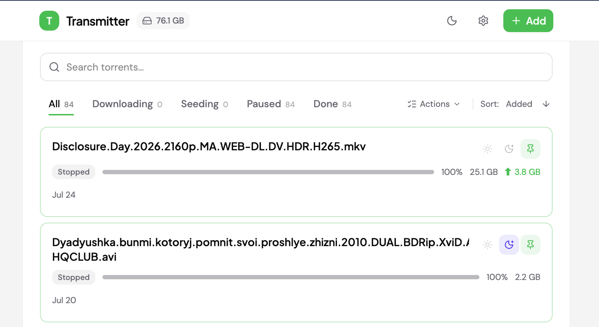
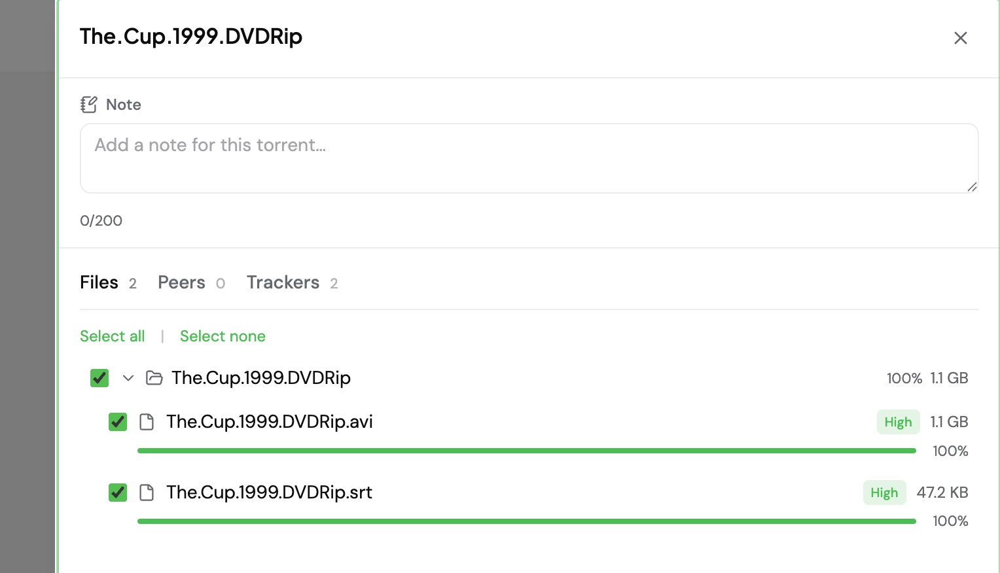

# Transmitter

[Русский](README.ru.md) | [Español](README.es.md) | [Deutsch](README.de.md)




Transmitter is a modern, lightweight alternative to Transmission's stock UI. Runs with zero external dependencies. Also Telegram bot integration.

## Features

- **Torrent basics** — sortable list (name, status, progress, size, speed, added date, ETA) with status filters, case-insensitive search, adding via magnet link or .torrent upload, and pause/resume/delete
- **Notes** — attach a custom text to any torrent (stored server-side in SQLite, shown in the list, the detail panel and the Telegram bot)
- **Night Shift** — mark torrents (moon-star button) to download and seed only inside a configured time window; outside the window they are paused
- **Day Shift** — the same, with its own label, window and a sun button; the two shifts are independent, a torrent may be marked for both
- **Shift switches** — each configured shift can be turned off in Settings → Shifts or from the Telegram bot (`/shifts`); the state is stored server-side in SQLite, so it applies to every browser and survives a restart. While a shift is off its scheduler touches nothing: torrents keep their current state and the shift button is greyed out
- **Impact** — how much a torrent gave back of what it took. A trophy marks the ones that uploaded 100% of their download, the «Not repaid» filter shows the rest (send them to a shift in bulk), and an optional switch stops a torrent once it reaches the target
- **Offline mode** — without a connection the UI still opens and shows the torrents, notes and settings as of the last sync, with a banner saying so; actions that need the server are unavailable until it is back. Opening the page itself offline requires HTTPS or localhost (service worker)
- **Support locales**: en, ru, es, de
- **Docker images**: linux/amd64, linux/arm/v7, linux/arm64/v8

## Getting Started

```bash
cp .env.example .env

# edit .env for your needs

docker-compose up -d
```

Open browser: `http://localhost:8080`

### Configuration

All settings via environment variables:

| Variable | Required | Default |
|-----------|----------|---------|
| `TRANSMISSION_USER` | Yes | — |
| `TRANSMISSION_PASS` | Yes | — |
| `TRANSMISSION_URL` | No | `http://localhost:9091/transmission/rpc` |
| `LISTEN_ADDR` | No | `127.0.0.1:8080` (Docker image: `0.0.0.0:8080`) |
| `CORS_ORIGIN` | No | `http://localhost:8080` |
| `WEBUI_ENABLED` | No | `true` |
| `TELEGRAM_BOT_ENABLED` | No | `false` |
| `TELEGRAM_TOKEN` | If using bot | — |
| `TELEGRAM_USERS` | If using bot | — |
| `LOG_LEVEL` | No | `info` |
| `FILE_PRIORITY_ENABLED` | No | `false` |
| `FILE_PRIORITY_HIGH_COUNT` | No | `3` |
| `NIGHT_SHIFT_START` | No | — (disabled) |
| `NIGHT_SHIFT_END` | No | — (disabled) |
| `NIGHT_SHIFT_INTERVAL` | No | `1m` |
| `DAY_SHIFT_START` | No | — (disabled) |
| `DAY_SHIFT_END` | No | — (disabled) |
| `DAY_SHIFT_INTERVAL` | No | `1m` |
| `DB_PATH` | No | `data/transmitter.db` (Docker image: `/app/data/transmitter.db`) |
| `TORRENT_NOTE_MAX_LENGTH` | No | `200` |
| `TORRENT_NOTE_CLEANUP_INTERVAL` | No | `1h` |
| `IMPACT_TARGET_RATIO` | No | `1` |
| `IMPACT_INTERVAL` | No | `5m` |
| `SENTRY_DSN` | No | — (disabled) |
| `SENTRY_ENVIRONMENT` | If using Sentry | — |

For all options, see [.env.example](.env.example).

## Security

See [SECURITY.md](docs/SECURITY.md).

## Roadmap

- Web UI authentication
- Video plugin
- Support multiple Transmission instances
- RSS feeds for automatic torrent addition
